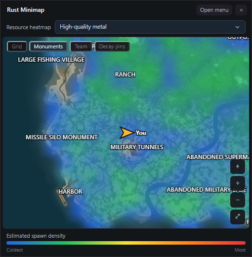

  
  <h1>Rust Companion</h1>
  
Live maps, team tracking and a floating minimap for Rust.

  
<strong>Windows x64</strong> · <strong>Version 0.1.0</strong> · Rust+ pairing

  
<a href="#downloads"><strong>Download for Windows</strong></a>

## Downloads

| Build | How to use it |
| :--- | :--- |
| [Windows installer](https://github.com/Vxfalcon/RustCompanion/raw/refs/heads/main/downloads/RustCompanionSetup.exe) | Install Rust Companion and add a Start menu shortcut. |
| [Portable app](https://github.com/Vxfalcon/RustCompanion/raw/refs/heads/main/downloads/RustCompanionPortable.exe) | Open the app directly without an installer. |

## What’s inside

<table>
  <tr>
    <td width="52%">
      <h3>Map and minimap</h3>
      
See your team, center the map on yourself, and customize your player marker. Move, resize and zoom the floating minimap while it follows your position.

      <h3>Resource heatmaps</h3>
      
Find likely spawn areas for ores, animals, hemp and food using terrain from the map Rust caches on your PC.

      <h3>Team and base tools</h3>
      
Manage paired smart devices, use team chat commands, and check raid costs, recycling yields and decay timers.

    </td>
    <td align="center"></td>
  </tr>
</table>

## First run

1. Open **Settings** in Rust Companion and link your Steam account.
2. In Rust, join a server with Rust+ enabled and select **Pair with Server**.
3. Open **Map**, then select **Open minimap** under **Map Controls**.
4. Press **Insert** to show or hide the main window.

The player arrow uses your direction of travel if the server omits facing data. Heatmap colors show estimated spawn density.

*An independent Windows app for Rust. Rust and Rust+ are products of Facepunch Studios.*

